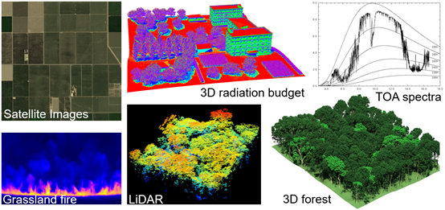

# 7th International Workshop on the DART Radiative Transfer Model  &mdash; Hong Kong

<!-- **A High-Fidelity, Large-Scale 3D Forest Plant Area Density Product Derived From Open-Access Airborne Lidar Data** -->

### Organizer

- Department of Land Surveying and Geo-Informatics, The Hong Kong Polytechnic University
- Center for the Study of the Biosphere from Space (CESBIO), CNRS-CNES-IRD-INREA-University of Toulouse III, Paul Sabatier
- IEEE Geoscience and Remote Sensing Society (GRSS) ― Hong Kong Chapter
- IEEE GRSS Modeling in Remote Sensing (MIRS) Technical Committee

### Overview

DART is one of the most precise and comprehensive 3D radiative transfer models in the remote sensing community. Developed at CESBIO since 1992 with support from CNRS, Université Toulouse III, CNES, IRD, and INRAE, and patented in 2003, DART enables the simulation of the radiative budget and remote sensing observations (radiometers and LiDAR) of any 3D urban and natural landscape. It has become an essential tool for studying land surfaces parameters (e.g., albedo, temperature) and processes (e.g., sun-induced florescence, urban heat island, and evapotranspiration). It is also a powerful tool for educational purposes on the physics of remote sensing and radiative transfer theory.

For the first time, the DART training will be held in Hong Kong, organized by the Department of Land Surveying and Geo-Informatics (LSGI), The Hong Kong Polytechnic University. This training will provide an overview of radiative transfer modeling, introduce the DART model and its diverse applications, and offer hands-on experience in simulating remote sensing observations and surface radiative budget, to help participants apply DART in their own research projects.

**Find more details from our [annoucement](https://connectpolyu-my.sharepoint.com/:b:/g/personal/23041573r_connect_polyu_hk/EewnorGJAYdBtefwMzBSXgEBGLtJjjmmAuAZjxF8mkJkWw?e=D0VJB7)**.

**Date: November 30 - December 03, 2025** \
**Location: ZS1001, The Hong Kong Polytechnic University** 

**Registration: Submit the [form](https://connectpolyu-my.sharepoint.com/:w:/g/personal/23041573r_connect_polyu_hk/EXT1xH3jLWBIh_C5Kv2A11cBTgYzloqeCAEGPRRtikVuiA?e=vqF26k) to [Cailin](mailto:cailin.zhou@connect.polyu.hk) or [Weiwei](mailto:weiwei.tan@connect.polyu.hk)** \
**Registration deadline: November 15, 2025**

**Number of participants: 30 (Seats are limited, first come first served)**\
**Contact: +852 3400 3897**
