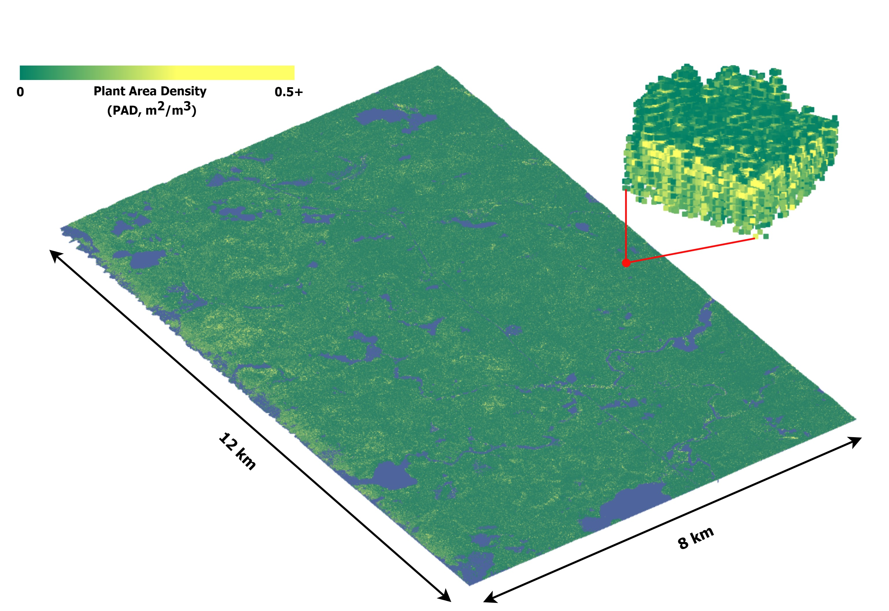

# FoScenes

**A High-Fidelity, Large-Scale 3D Forest Plant Area Density Product Derived From Open-Access Airborne Lidar Data**

The preliminary version of FoScenes releases 40 seamless scenes over 28 diverse sites, with individual area ranging from 50 to about 11,000 hectares, using ALS data acquired by NASA Goddard’s LiDAR, Hyperspectral & Thermal Imager [(G-LiHT)](https://glihtdata.gsfc.nasa.gov/).

### Paper

Zhou, C., Yin, T., Wei, S., Cook, B.D., Tan, W., Yan, W.Y., Chen, Q., Gastellu-Etchegorry, J.-P., 2026. FoScenes: A high-fidelity, large-scale 3D forest plant area density product derived from open-access airborne lidar data. Remote Sens. Environ. 333, 115150. https://doi.org/10.1016/j.rse.2025.115150

### Sites map

From the tropical rainforests in Puerto Rico to the broadleaf-needleleaf mixed forests in Northeast US, FoScenes provides realistc representations across major forest biomes in North America.

### A Sample

The largest scene (about 11,500 ha) is for the WLEF site located 24 km west of Park Falls, Wisconsin, in the Chequamegon Nicolet National Forest.

## Download
[Google Drive](https://drive.google.com/drive/folders/1MO6odlAwKpRAWvHlDw8XkZ8CHGD_FJK4?usp=drive_link)

## Description
### 3D space
Defined a 3D space by the projection, minimum borders and sizes.
- proj.txt: Well-known text (WKT) string of the projection system.
- bord_size.txt: [*Min_UTM_X, Min_UTM_Y, Elev_Lowest, Size_Of_X, Size_Of_Y, Size_Of_Z*]. 

All in meter. Elevation is based on EGM96 geoid.

### Voxel files
Each row records **the index in 3D voxelized space** or **center coordinate** of a voxel, with its PAD.
- vox_pad_ind.txt: [*x_index, y_index, z_index, PAD*] 
- vox_pad_coord.txt: [*x, y, z, PAD*]

### DTM
The terrain point cloud generated from 1-m DTM grid.

- dtm_cloud.txt: [*x, y, z*]
- dtm_dart.txt: [*col, row, z*] in DART coordinate system (image coordinate system).

### PAI map
- Geotiff file: PAI (plant area index) maps by vertical integration, can be used for quality control. (Good quality: LAI>0, Non-vegetated: LAI=0, Insufficient lidar sampled: LAI=-1)

## Use FoScenes in DART
FoScenes can be easily used in [DART](https://dart.omp.eu/) for various simulation with DAO tools 
([DAO python scripts](https://drive.google.com/drive/folders/1LwEC1xPIfSWLTACyEBj2goRh0qzAHd5H?usp=drive_link)).

## Contact

For inquiries regarding FoScenes, please reach out to [Cailin](mailto:cailinzhou.polyu@gmail.com).

We are open to collaborations in various forms. Please contact [Dr.YIN](https://www.polyu.edu.hk/lsgi/people/academic-staff/prof-yin-tiangang/) for futher details.
