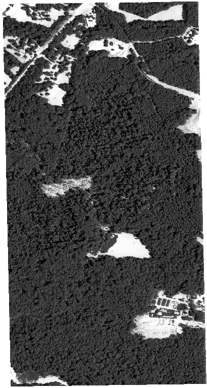
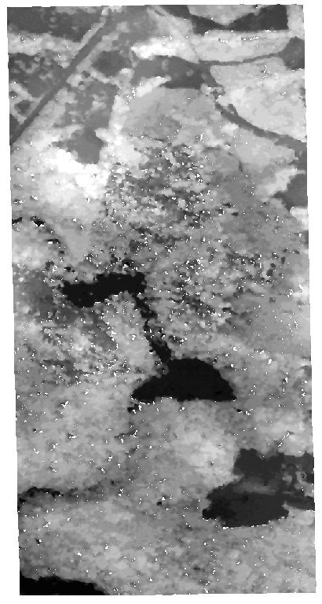

# JitStereo-FoScenes

> Tan, W., Yin, T., et al.  
> **Modeling Satellite Jitter’s Effect on Forest Canopy Surface Retrieval Using Spaceborne Stereogrammetry**.  
> *Remote Sensing of Environment*, manuscript in preparation / under submission.

**Paper access**: Coming soon after official publication.

JitStereo-FoScenes is a preliminary demonstration dataset for physically-based simulation of satellite jitter effects on stereo satellite imagery and forest canopy surface retrieval. It is built upon realistic forest structure scenes derived from the LS-PVlad / FoScenes framework and the Discrete Anisotropic Radiative Transfer model [(DART)](https://dart.omp.eu/).

The current release focuses on the SERC forest site and demonstrates the generation of no-jitter and jitter-affected stereo satellite-like imagery, together with DSM products for evaluating the influence of satellite jitter on forest canopy surface reconstruction.

---

### Overview

JitStereo-FoScenes aims to support physically-based analysis of satellite jitter effects in spaceborne stereogrammetry over complex forest scenes.

The current simulation workflow includes:

1. Preparation of realistic 3D forest scenes from the LS-PVlad / FoScenes framework.
2. Block-wise physically-based no-jitter stereo image simulation using DART.
3. Jitter-affected stereo image simulation based on no-jitter DART simulation results.
4. DSM reconstruction from no-jitter and jitter-affected stereo image pairs.

The current demonstration focuses on the SERC forest site and provides DART-simulated stereo imagery for analyzing how satellite jitter influences image geometry, stereo matching, and DSM reconstruction over forest canopies.

---

### Updates

#### [In Progress🔧]

- Prepare the manuscript for submission to *Remote Sensing of Environment*.
- Release DART-simulated jitter stereo imagery through an online data link.
- Improve the documentation of jitter modeling, DART block simulation, and DSM reconstruction.
- Extend JitStereo-FoScenes to additional forest sites and jitter scenarios.
- Provide more examples with different jitter amplitudes, frequencies, and viewing geometries.

[v0.1] 2026-XX-XX Initial release

- Release the SERC demonstration dataset.
- Provide DART-simulated no-jitter stereo imagery.
- Provide DART-simulated jitter-affected stereo imagery.
- Provide preview animations for web visualization:
  - `SERC_jitter.jif`
  - `SERC_DSM_jitter.jif`
- Provide the main processing scripts for no-jitter and jitter DART block simulations:
  - `no_jitter_scene_smaller_clip_lux_100cameras_NadirOffnadir.py`
  - `jitter_simulation_smaller_clip_Nadir_OffNadir.py`

---

### Download

- **JitStereo-FoScenes datasets [v0.1]**:  
  [Data Link](https://drive.google.com/drive/u/1/folders/1rhwz8wUrxIVF-kgoU94f-50R5rxi8wOx)

- **Processing codes and workflow scripts**:  
  [Code / Tools](https://drive.google.com/drive/u/1/folders/1nqXHbFQ94zDU11ADXuCfTqug5yAXc5Kv)

<!-- - **README and file description**:  
  [README](PUT_README_LINK_HERE) -->

---

### Data Description

The current release contains DART-simulated no-jitter stereo imagery, jitter-affected stereo imagery, DSM-related products, preview animations, and processing scripts for the SERC demonstration site.

#### 1. No-jitter Stereo Imagery

The no-jitter stereo imagery is generated using DART over a realistic SERC forest scene derived from the LS-PVlad / FoScenes framework.

The no-jitter simulation serves as the reference condition for evaluating satellite jitter effects. It represents an ideal satellite stereo acquisition without platform jitter or line-dependent attitude perturbations.

The simulation is performed using nadir and off-nadir stereo viewing configurations.

Main script:

- `no_jitter_scene_smaller_clip_lux_100cameras_NadirOffnadir.py`:  
  performs block-wise DART simulation of no-jitter stereo imagery using nadir and off-nadir viewing configurations.

---

#### 2. Jitter-affected Stereo Imagery

The jitter-affected stereo imagery is generated based on the no-jitter DART simulations.

Satellite jitter is introduced into the stereo simulation workflow to represent small platform attitude perturbations and line-dependent viewing geometry variations. These jitter-induced perturbations can cause image displacement, geometric distortion, stereo matching degradation, and DSM reconstruction errors.

Main script:

- `jitter_simulation_smaller_clip_Nadir_OffNadir.py`:  
  performs block-wise DART simulation of jitter-affected stereo imagery based on the no-jitter DART simulation results.

The released jitter imagery will be provided through the online data link listed in the **Download** section.

---

#### 3. DSM Products

DSM products can be reconstructed from both no-jitter and jitter-affected stereo image pairs.

The DSM products are used to evaluate the influence of satellite jitter on forest canopy surface retrieval, including elevation bias, local surface distortion, canopy height error, stereo matching degradation, and spatial patterns of jitter-induced artifacts.

The exact file names may be updated according to the final release package.

---

#### 4. Preview Animations

The following animation files are provided for quick visualization on this webpage:

- `SERC_jitter.jif`: visualization of DART-simulated jitter effects in SERC stereo imagery.
- `SERC_DSM_jitter.jif`: visualization of jitter-induced effects on SERC DSM reconstruction.

These JIF files are intended for web visualization only. Please use the released simulation products and GeoTIFF files for scientific analysis.

---

#### 5. Processing Code

The released code documents the major steps required to reproduce or adapt the JitStereo-FoScenes workflow for the SERC site.

Released scripts:

- `no_jitter_scene_smaller_clip_lux_100cameras_NadirOffnadir.py`  
  Performs block-wise DART line-by-line simulation of no-jitter stereo satellite imagery using nadir and off-nadir viewing configurations.

- `jitter_simulation_smaller_clip_Nadir_OffNadir.py`  
  Performs block-wise DART line-by-line simulation of jitter-affected stereo satellite imagery based on the no-jitter DART simulations.

---

### Contact & Collaboration

We welcome collaborations in various forms. If you are interested in physically-based satellite jitter simulation, spaceborne stereogrammetry, DART simulation, or forest canopy surface retrieval, please feel free to reach out.

For general inquiries regarding JitStereo-FoScenes, please contact  
**Weiwei**: [13071218240cug@gmail.com](mailto:13071218240cug@gmail.com)

For collaboration opportunities and further details, please contact  
**Tiangang**: [tiangang.yin@polyu.edu.hk](mailto:tiangang.yin@polyu.edu.hk)
