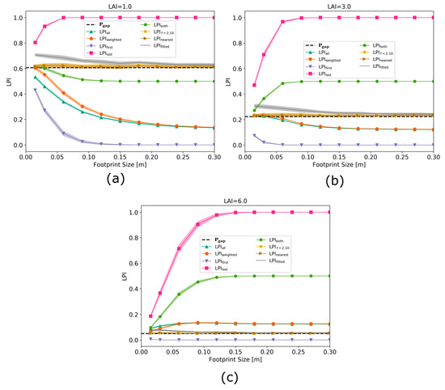

## Photogrammetry investigation with 3D-RTM

Together, these papers develop and apply a new method to simulate stereo imagery in a 3-D radiative transfer model, with an emphasis on the use of stereo-derived surface models to understand complex forested ecosystems. The first paper describes the novel approach to model stereo imagery in DART and confirms the consistency between simulated and actual WorldView data. The second one conducts a comprehensive sensitivity study of the critical sensor configurations and environmental conditions that influence the accuracy of derived stereo digital surface models over complex forested scenes.

**Yin, T.**, Montesano, P.M., Cook, B.D., Chavanon, E., Neigh, C.S., Shean, D., Peng, D., Lauret, N., Mkaouar, A., Morton, D.C. and Regaieg, O., 2023. Modeling forest canopy surface retrievals using very high-resolution spaceborne stereogrammetry:(I) methods and comparisons with actual data. ***Remote Sensing of Environment***, 298, p.113825. [[Access paper]](https://www.sciencedirect.com/science/article/pii/S0034425723003760#f0040)

**Yin, T.**, Montesano, P.M., Cook, B.D., Chavanon, E., Neigh, C.S., Shean, D., Peng, D., Lauret, N., Mkaouar, A., Regaieg, O. and Zhen, Z., 2023. Modeling forest canopy surface retrievals using very high-resolution spaceborne stereogrammetry:(II) optimizing acquisition configurations. ***Remote Sensing of Environment***, 298, p.113824. [[Access paper]](https://www.sciencedirect.com/science/article/pii/S0034425723003759#f0005)

## Forest 3D reconstruction driven by Aiborne LiDAR data

**In-depth study and intercomparisons of the existing leaf area index inversion approaches of small-footprint ALS**

**Yin, T.**, Qi, J., Cook, B. D., Morton, D. C., Wei, S., & Gastellu-Etchegorry, J. P. (2019). Modeling small-footprint airborne LiDAR-derived estimates of gap probability and leaf area index. ***Remote Sensing***, 12(1), 4. [[Access paper]](https://www.mdpi.com/2072-4292/12/1/4)

**PVlad: Path-volume-based ALS-driven 3D forest reconstruction model**

**Yin, Tiangang**, Bruce D. Cook, and Douglas C. Morton. "Three-dimensional estimation of deciduous forest canopy structure and leaf area using multi-directional, leaf-on and leaf-off airborne lidar data." ***Agricultural and Forest Meteorology*** 314 (2022): 108781. [[Access paper]](https://www.sciencedirect.com/science/article/pii/S0168192321004676)

**FoScenes: A High-Fidelity, Large-Scale 3D Forest Plant Area Density Product Derived From Open-Access Airborne Lidar Data**

