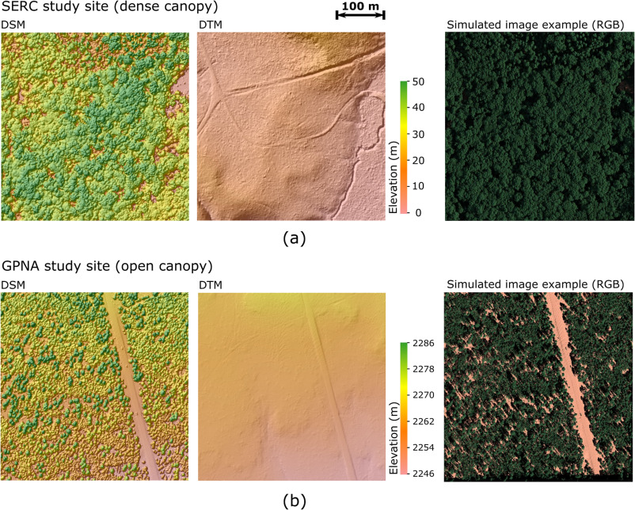

## Photogrammetry and radiative transfer simulation

**Configuration investigation on Digital surface models (DSM) retrieval based on simulated VHR spaceborne stereogrammetry**

**Yin, T.**, Montesano, P.M., Cook, B.D., Chavanon, E., Neigh, C.S., Shean, D., Peng, D., Lauret, N., Mkaouar, A., Morton, D.C. and Regaieg, O., 2023. Modeling forest canopy surface retrievals using very high-resolution spaceborne stereogrammetry:(I) methods and comparisons with actual data. **Remote Sensing of Environment**, 298, p.113825. [[Access paper]](https://www.sciencedirect.com/science/article/pii/S0034425723003760#f0040)

**Yin, T.**, Montesano, P.M., Cook, B.D., Chavanon, E., Neigh, C.S., Shean, D., Peng, D., Lauret, N., Mkaouar, A., Regaieg, O. and Zhen, Z., 2023. Modeling forest canopy surface retrievals using very high-resolution spaceborne stereogrammetry:(II) optimizing acquisition configurations. Remote Sensing of Environment, 298, p.113824. [[Access paper]](https://www.sciencedirect.com/science/article/pii/S0034425723003759#f0005)

## Forest 3D reconstruction driven by Aiborne LiDAR

**PVlad: Path-volume-based ALS-driven 3D forest reconstruction model**

**Yin, Tiangang**, Bruce D. Cook, and Douglas C. Morton. "Three-dimensional estimation of deciduous forest canopy structure and leaf area using multi-directional, leaf-on and leaf-off airborne lidar data." **Agricultural and Forest Meteorology** 314 (2022): 108781.

**

