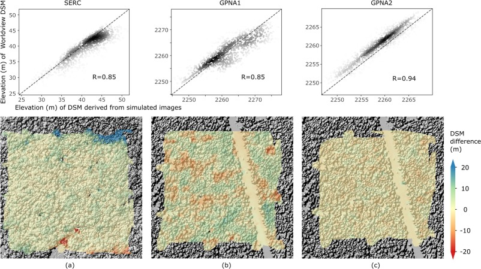
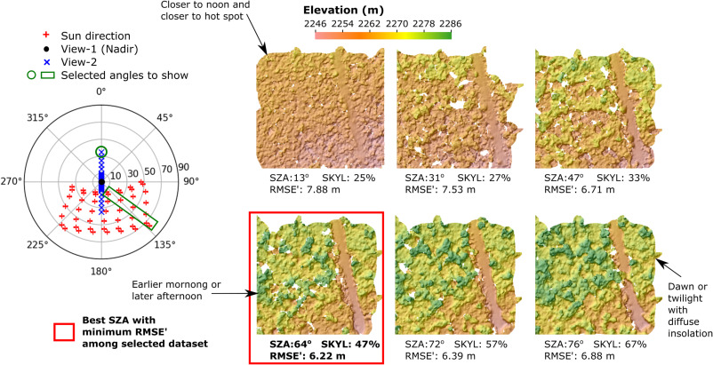
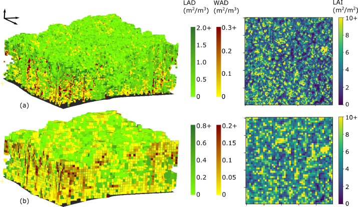
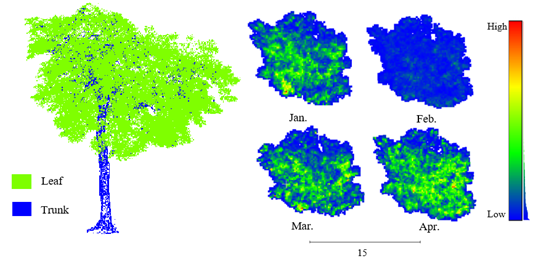

## Digital Surface Model (DSM) Reconstruction from Satellite Stereo Images

Together, these papers develop and apply a new method to simulate stereo imagery in a 3-D radiative transfer model, with an emphasis on the use of stereo-derived surface models to understand complex forested ecosystems. The first paper describes the novel approach to model stereo imagery in DART and confirms the consistency between simulated and actual WorldView data. The second one conducts a comprehensive sensitivity study of the critical sensor configurations and environmental conditions that influence the accuracy of derived stereo digital surface models over complex forested scenes.

**Yin, T.**, Montesano, P.M., Cook, B.D., Chavanon, E., Neigh, C.S., Shean, D., Peng, D., Lauret, N., Mkaouar, A., Morton, D.C. and Regaieg, O., 2023. Modeling forest canopy surface retrievals using very high-resolution spaceborne stereogrammetry:(I) methods and comparisons with actual data. ***Remote Sensing of Environment***, 298, p.113825. [[Access paper]](https://www.sciencedirect.com/science/article/pii/S0034425723003760#f0040)

**Yin, T.**, Montesano, P.M., Cook, B.D., Chavanon, E., Neigh, C.S., Shean, D., Peng, D., Lauret, N., Mkaouar, A., Regaieg, O. and Zhen, Z., 2023. Modeling forest canopy surface retrievals using very high-resolution spaceborne stereogrammetry:(II) optimizing acquisition configurations. ***Remote Sensing of Environment***, 298, p.113824. [[Access paper]](https://www.sciencedirect.com/science/article/pii/S0034425723003759#f0005)

## Forest 3D reconstruction driven by Aiborne LiDAR data

The physical structure of canopy, characterized as the three-dimensional (3D) distribution of leaves and branches, determines the canopy radiation regime, thus influencing forests photosynthesis rates, plant growth, and gross primary productivity. We develop a data processing workflow (**PVlad**) using ALS point cloud apparent reflectance to estimate LAI and voxel-based leaf area density (LAD), aiming to reduce the need for associated field measurements such as the gap probability. By developing a scaling up workflow we created the first release of **FoScenes**—a high-fidelity PAD product comprising 40 seamless scenes from 28 diverse forest sites, with individual area ranging from ∼50 to ∼11,000 ha. By providing multi-dimensional forest characterizations, FoScenes enables temporal insights into structure dynamics. Its integration with the discrete anisotropic radiative transfer (DART) model underscores the potential of FoScenes for extensive 3D RTM applications at various scales.

**Yin, Tiangang**, Bruce D. Cook, and Douglas C. Morton. "Three-dimensional estimation of deciduous forest canopy structure and leaf area using multi-directional, leaf-on and leaf-off airborne lidar data." ***Agricultural and Forest Meteorology*** 314 (2022): 108781. [[Access paper]](https://www.sciencedirect.com/science/article/pii/S0168192321004676)

**Zhou, C., Yin, T.**, Wei, S., Cook, B.D., Tan, W., Yan, W.Y., Chen, Q., Gastellu-Etchegorry, J.-P., 2026. FoScenes: A high-fidelity, large-scale 3D forest plant area density product derived from open-access airborne lidar data. **Remote Sens. Environ.** 333, 115150. [[Access paper]](https://doi.org/10.1016/j.rse.2025.115150)

## Urban Vegetation Monitoring

Urban trees are crucial for human well-being, necessitating precise monitoring of metrics like count, leaf area, and health. Manual surveys are inefficient, so LiDAR combined with multisource data enables accurate large-scale and long-term tracking. Our team collected extensive and long-term LiDAR data from hundreds of Hong Kong trees, collaborating with local authorities. We use single-tree point cloud processing—branch and leaf classification, occlusion completion, 3D reconstruction, and biomass/leaf area density estimation—enhanced by deep learning on both empirical and simulated data.

**More Highlights: <https://www.polyu.edu.hk/lsgi/news-and-events/news/2025/0605-prof-tiangang-yin>**