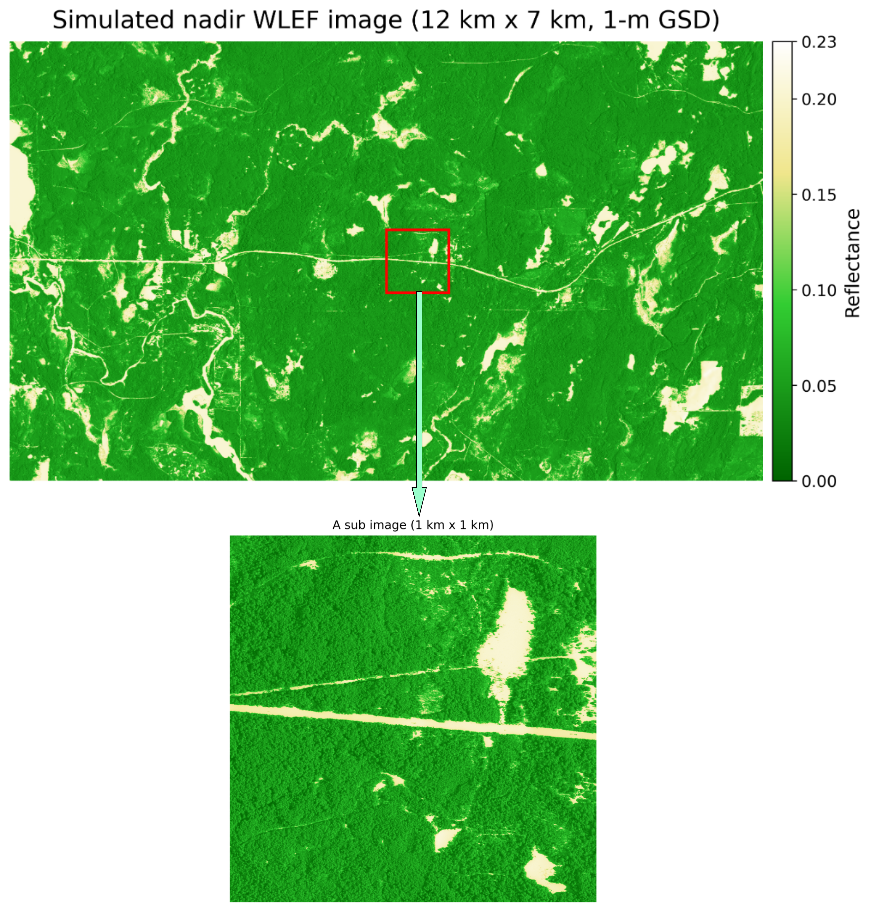
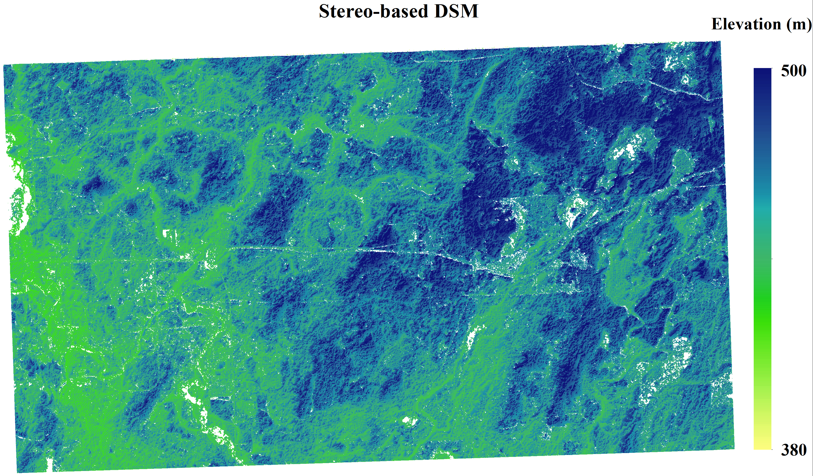

# Stereo-FoScenes

> Tan, W., Yin, T., Wei, S., Zhou, C., Chavanon, E., Lauret, N., Mkaoua, A., Shean, D., Alexandrov, O., Neigh, C. S. R., Montesano, P. M., & Gastellu-Etchegorry, J.-P.  
> **Simulation of Large-scale Stereo Satellite Images for Forest Observation Using Discrete Anisotropic Radiative Transfer (DART) Model**.  
> *IGARSS 2026*, conference presentation and publication pending.

**Paper access**: Coming soon after official publication.

Stereo-FoScenes is a preliminary demonstration product for large-scale, physically-based stereo satellite image simulation and forest digital surface model (DSM) reconstruction. It is built upon realistic forest structure scenes derived from the LS-PVlad / FoScenes framework and the Discrete Anisotropic Radiative Transfer model [(DART)](https://dart.omp.eu/).

The current release focuses on the WLEF forest site and demonstrates the generation of very-high-resolution stereo satellite-like image pairs and stereo-derived DSM products over a large forested area.

---

### Overview

Stereo-FoScenes aims to support large-scale, realistic radiative transfer simulations for forest observation and stereo photogrammetric analysis.

The current simulation workflow includes:

1. Conversion of the LS-PVlad / FoScenes voxelized forest scene from the EGM96 coordinate system to the Earth-Centered Earth-Fixed (ECEF) coordinate system.
2. Block-wise physically-based stereo image simulation using DART.
3. Construction of pushbroom imaging geometry in the ECEF coordinate system.
4. Generation of ground control points (GCPs) linking ECEF coordinates, longitude/latitude/height, and image pixel coordinates.
5. Estimation of RPC-compatible metadata for the simulated stereo images.
6. DSM reconstruction from the simulated stereo image pair.

The current demonstration simulates a large-scale stereo pair over the WLEF forest site, with a spatial extent of approximately **12 km × 7 km** and a ground sampling distance of **1 m**.

---

### Updates

#### [In Progress🔧]

- Extend Stereo-FoScenes to additional forest sites and forest types.
- Release more stereo configurations with different viewing geometries.
- Improve the documentation of pushbroom camera models, GCP generation, RPC metadata, and DSM reconstruction scripts.
- Prepare the official paper link after the IGARSS publication.

[v0.1] 2026-XX-XX Initial release

- Release the WLEF demonstration stereo image pair.
- Provide simulated DART stereo images in GeoTIFF format:
  - `VZA_0_RPC.tif`
  - `VZA_20_RPC.tif`
- Provide the stereo-derived DSM product.
- Provide preview figures for web visualization:
  - `DART_WLEF_show.png`
  - `WLEF_DSM_Stereo.png`
- Provide the main processing scripts for coordinate conversion, DART simulation, GCP generation, RPC metadata generation, and DSM reconstruction.

---

### Download

- **Stereo-FoScenes WLEF datasets [v0.1]**:  
  [Google Drive](https://drive.google.com/drive/u/1/folders/1O6OtFRUst4chpv0APm0xPibcDuENKbRN)

- **Processing codes and workflow scripts**:  
  [Code / Tools](https://drive.google.com/drive/u/1/folders/1lNUvILHrNr0L91kMS6cVhikIvXNOBIKv)

- **README and file description**:  
  [README](PUT_README_LINK_HERE)

---

### Data Description

The current release contains simulated stereo image products, RPC-ready GeoTIFF images, DSM products, preview figures, and processing scripts for the WLEF demonstration site.

#### 1. Simulated Stereo Image Pair

The stereo image pair is generated using DART over a realistic WLEF forest scene derived from the LS-PVlad / FoScenes framework.

Released files:

- `VZA_0_RPC.tif`: simulated near-nadir image with a view zenith angle of 0°.
- `VZA_20_RPC.tif`: simulated oblique image with a view zenith angle of 20°.

These GeoTIFF files are prepared for stereo photogrammetric processing and are associated with RPC-compatible metadata generated by the processing workflow.

The stereo pair is designed to represent satellite-like pushbroom observations over a large forested scene.

---

#### 2. Stereo-derived DSM Product

The DSM product is reconstructed from the simulated stereo image pair.

Released DSM data:

- `WLEF_stereo_DSM.tif`: stereo-derived DSM product generated from the simulated stereo images.  
  The exact file name may be updated according to the final release package.

The DSM is provided in GeoTIFF format and can be used for evaluating stereo reconstruction performance over forested areas.

For the current WLEF demonstration, spatial products are projected in **UTM Zone 15N**.

---

#### 3. Preview Figures

The following figures are provided for quick visualization on this webpage:

- `DART_WLEF_show.png`: visualization of the DART-simulated WLEF stereo image products.
- `WLEF_DSM_Stereo.png`: visualization of the stereo-derived WLEF DSM product.

These PNG files are intended for web visualization only. Please use the GeoTIFF products for scientific analysis.

---

#### 4. Processing Code

The released code documents the major steps required to reproduce or adapt the Stereo-FoScenes workflow for the WLEF site.

Released scripts:

- `conversion_vox_EGM96_to_ECEF_WLEF.py`  
  Converts the WLEF LS-PVlad / FoScenes voxelized scene from the EGM96-referenced coordinate system to the ECEF coordinate system.

- `WLEF_pushbroom_ECEF_block_process.py`  
  Generates block-wise DART simulations using a pushbroom imaging geometry defined in the ECEF coordinate system.

- `WLEF_GCP_ECEF_to_pixel_llh.py`  
  Generates ground control points by linking ECEF coordinates, pixel coordinates, and longitude/latitude/height information.

- `rpc_dev_for_las_WLEF_ECEF_push.py`  
  Generates RPC metadata for the simulated WLEF pushbroom stereo images.

- `bulk_process_WLEF.py`  
  Performs batch processing for DSM generation from the simulated stereo image pair.

---

### Contact & Collaboration

We welcome collaborations in various forms. If you have your own lidar data and are interested in forest structure reconstruction on your sites, please feel free to reach out.

For general inquiries regarding Stereo-FoScenes, please contact  
**Weiwei**: [13071218240cug@gmail.com](mailto:13071218240cug@gmail.com)

For collaboration opportunities and further details, please contact  
**Tiangang**: [tiangang.yin@polyu.edu.hk](mailto:tiangang.yin@polyu.edu.hk)
